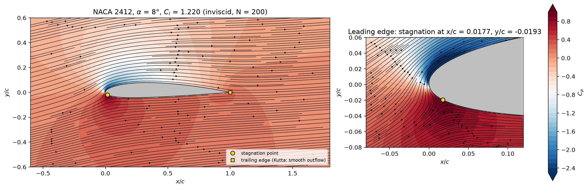
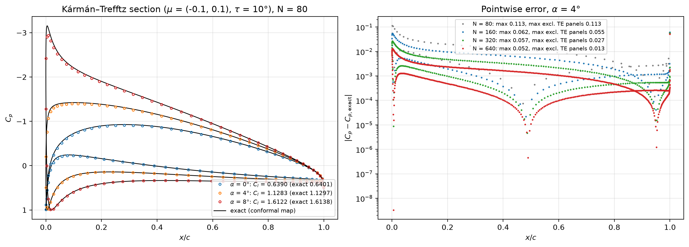
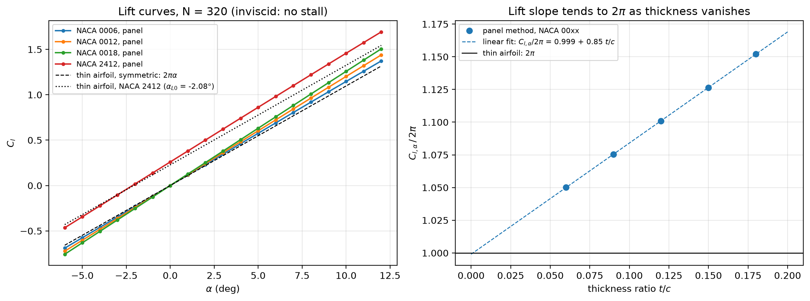
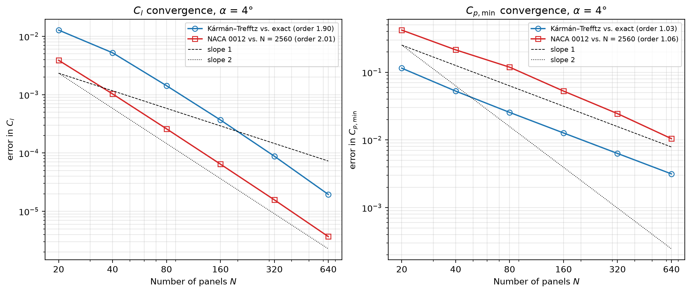
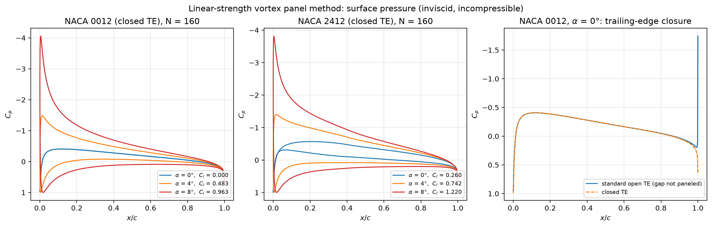
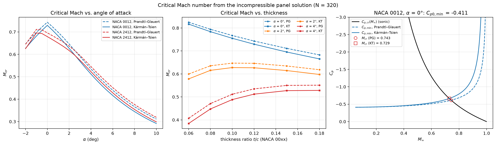
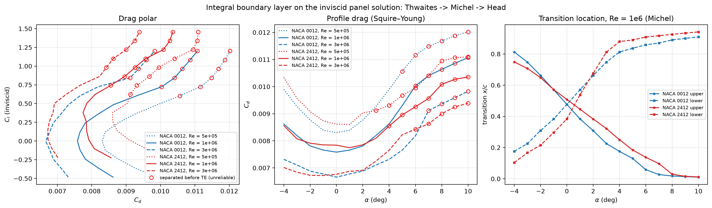

# Vortex Panel Method Airfoil Solver

**Live app:** _link added after deployment to Streamlit Community Cloud_ &nbsp;·&nbsp; **CLI:** `airfoil-analyze --naca 2412 --alpha -4:12:1 --mach 0,0.3,0.5 --re 1e6 --out results/`

A linear-strength vortex panel solver for 2D airfoils, validated against an exact conformal-map solution and thin-airfoil theory, extended with Prandtl–Glauert and Kármán–Tsien compressibility corrections, a critical-Mach analysis, an integral boundary-layer drag estimate, and an analysis tool (command line and web app) built entirely on this solver.

*Badr Elsayed. Python / NumPy / SciPy, vectorized; 104 automated tests.*



## Motivation

Panel methods are the backbone of preliminary aerodynamic design. They solve the inviscid flow around an arbitrary shape in milliseconds, which makes them the tool of choice for sweeping hundreds of geometries and angles before any expensive CFD is run, and they are the inviscid core of design codes such as XFOIL. This project builds one from first principles, checks it against problems with known answers, and then layers on the corrections that turn an inviscid, incompressible solution into useful engineering estimates: compressibility up to the critical Mach number, and viscous drag from boundary-layer theory.

## Governing equations

For inviscid, incompressible, irrotational flow the velocity is the gradient of a potential that satisfies **Laplace's equation**, $\nabla^2\phi = 0$. Laplace's equation is linear, so the flow can be built by **superposition**: a uniform free stream plus a **vortex sheet** wrapped around the airfoil surface, whose strength $\gamma(s)$ is the unknown. Two conditions fix it:

- **Flow tangency:** the surface is a streamline, so the velocity normal to the wall is zero.
- **Kutta condition:** the flow leaves the sharp trailing edge smoothly, $\gamma_{TE,\,upper} + \gamma_{TE,\,lower} = 0$. Without it the solution is not unique (any circulation satisfies tangency); with it the circulation, and therefore the lift, is determined.

**Discretization (Kuethe & Chow §5.10).** The surface is divided into $N$ straight panels with cosine spacing (clustered at the leading and trailing edges). On each panel $\gamma$ varies linearly between nodal values $\gamma_j$, giving $N+1$ unknowns. Tangency at the $N$ panel midpoints plus the Kutta condition give an $(N+1)\times(N+1)$ linear system $A_n\,\gamma' = \sin(\theta_i - \alpha)$. The influence coefficients are closed-form integrals of the velocity induced by a linear vortex panel. Surface velocity follows from a second coefficient matrix, $V_i/V_\infty = \cos(\theta_i - \alpha) + \sum_j A_{t,ij}\gamma'_j$, and $C_p = 1 - (V/V_\infty)^2$. Lift is computed two independent ways: from the circulation (Kutta–Joukowski, $C_l = 2\Gamma/V_\infty c$) and by integrating the surface pressure.

**Verification of the coefficients.** Sign and index errors in the influence coefficients are the classic failure of this method. Every closed-form coefficient is checked against direct numerical integration of the vortex sheet, panel by panel, and agrees to $10^{-8}$; the self-influence terms are checked as principal-value integrals.

## Validation

All figures are regenerated by `python scripts/make_figures.py` (about 5 s). Unless noted, NACA sections use the closed-trailing-edge thickness form (see *Trailing edge* below).

### Exact solution: Kármán–Trefftz airfoil



The Kármán–Trefftz map turns the flow around a circle, which is known exactly, into the flow around a cambered airfoil with a finite trailing-edge angle. At N = 160 the panel lift is within **0.03%** of the exact value, and it converges at second order. The pressure distribution converges at first order everywhere except on the panels touching the trailing edge, where the error stays near 0.05. This is a property of the exact solution, not of the code: with the Kutta condition satisfied at a wedge of angle τ, the exact speed vanishes like $r^{\tau/(2\pi-\tau)}$, an exponent of only 0.029 for τ = 10°, so the true $C_p$ rises to 1 inside a layer far thinner than any panel.

### Thin-airfoil theory



Thin-airfoil theory predicts a lift slope of $2\pi$ per radian for any section. A panel method includes thickness, which raises the slope: NACA 0006, 0012 and 0018 give $1.050$, $1.101$ and $1.152 \times 2\pi$. The slope grows linearly with thickness, and the fit extrapolates to $0.999\times 2\pi$ at zero thickness, the thin-airfoil limit. For the cambered NACA 2412, the panel method gives a zero-lift angle of −2.15° and $C_{m,c/4} = -0.055$, against −2.08° and −0.053 from thin-airfoil theory; the small differences are thickness effects.

### Consistency checks

- A symmetric section at α = 0 gives $C_l = 0$ and $C_m = 0$ to below $10^{-13}$, with mirror-symmetric $C_p$.
- Kutta–Joukowski and pressure-integrated lift agree to 0.29% at N = 320, within the 0.5% target. At N = 160 the gap is 0.58%: pressure integration samples one $C_p$ per straight panel and converges at first order, so the gap halves each time N doubles, as does the spurious pressure drag (exactly zero in potential flow). The Kutta–Joukowski value is the accurate one (5 digits by N = 160).
- NACA 0012 at α = 0: $C_{p,\min} = -0.408$, against the classical −0.41 (Abbott & von Doenhoff).

### Panel convergence



Errors are measured against the exact Kármán–Trefftz solution and, for NACA 0012, against an N = 2560 solution. Lift converges at second order (observed 1.90 and 2.01) because it is an integral of the solution, in which local errors cancel; the minimum pressure converges at first order (1.03 and 1.06) because it is a pointwise value at the sharp leading-edge suction peak. For design work, N = 160–320 gives lift to better than 0.05%; $C_{p,\min}$ is harder, with errors of 0.006–0.025 at N = 320.

### Comparison with XFOIL

Inviscid XFOIL results for NACA 0012 and 2412 at α = 0°, 4° and 8° plug into `scripts/xfoil_compare.py`, which overlays them on the panel solution. _The reference data are being generated; the figure appears here once they are in `data/xfoil/`._

### Trailing edge

The standard NACA thickness formula leaves a gap of 0.25% chord at the trailing edge. The Kuethe & Chow formulation assumes a closed body, so the unpaneled gap produces a spurious suction peak ($C_p \approx -1.7$) on the two trailing-edge panels, although the rest of the surface is unaffected. The solver therefore uses the closed-trailing-edge variant (last thickness coefficient −0.1036 instead of −0.1015), which changes the half-thickness by at most 0.13% chord, at the trailing edge, for a 12% section.



## Compressibility and critical Mach number

The incompressible $C_p$ is corrected with **Prandtl–Glauert**, $C_p = C_{p0}/\sqrt{1-M_\infty^2}$, and **Kármán–Tsien**, $C_p = C_{p0}/\big[\sqrt{1-M_\infty^2} + \tfrac{M_\infty^2}{1+\sqrt{1-M_\infty^2}}\tfrac{C_{p0}}{2}\big]$. The **critical Mach number** is where the corrected minimum pressure first reaches the sonic value $C_{p,cr}(M_\infty)$, found with a bracketed root finder.



For NACA 0012 at α = 0 the method gives $M_{cr}$ = 0.743 (Prandtl–Glauert) and 0.729 (Kármán–Tsien); the code reproduces Anderson's textbook example ($C_{p0,\min}$ = −0.43 → $M_{cr}$ = 0.74) as a test. Kármán–Tsien always predicts the lower value because it corrects strong suction peaks more aggressively. $M_{cr}$ falls steeply with angle of attack, from about 0.73 at 0° to 0.3 at 10°, as the leading-edge suction peak grows. The thickness trend reverses with incidence: at α = 0 thicker sections reach sonic flow sooner, but by α = 4° the thinnest section (NACA 0006) has the lowest $M_{cr}$, because its sharper nose produces the strongest suction spike.

## Viscous drag estimate (integral boundary layer)



Drag is estimated by marching an integral boundary layer along each surface on the inviscid edge velocity: **Thwaites'** method for the laminar part, **Michel's** criterion for transition, **Head's** entrainment method for the turbulent part, and the **Squire–Young** formula for the profile drag at the trailing edge. Each piece is tested against flat-plate theory: Thwaites reproduces the Blasius momentum thickness to about 1%, Head's method matches the 1/7-power-law turbulent drag to within 15%, and Michel's criterion places flat-plate transition at $Re_x \approx 1.7\times10^6$.

The trends are physically right: a drag bucket around the design lift, lower drag at higher Reynolds number, transition moving forward on the upper surface and aft on the lower surface with incidence, and turbulent separation (flagged with open red circles) appearing as α rises. The absolute values are approximate. For NACA 0012 at Re = $10^6$ the method gives $C_d$ ≈ 0.0076 with transition at 48% chord, consistent with a classical estimate for that transition location (flat-plate mixed-flow drag times a thickness form factor, ≈ 0.0074). Michel's criterion predicts transition earlier than the $e^N$ method used by XFOIL, so drag is expected to come out higher than XFOIL's, and agreement should only be expected at low angles of attack, before separation. Two modeling choices are worth stating: marching stops at 99% chord, because the inviscid trailing-edge stagnation point (which a real viscous wake removes) would otherwise trigger spurious separation; and laminar separation is treated as forcing transition (a short laminar bubble).

## Analysis tool

`sweep(airfoil, alphas, machs, reynolds)` returns one row per α × M × Re with lift, moment, minimum pressure, critical Mach, drag, transition and validity flags. The influence matrix depends only on geometry, not on α, so it is **LU-factorized once** and reused for every angle in the sweep; Mach and Reynolds enter only through post-processing, so a full sweep costs little more than a single solve.

```bash
airfoil-analyze --naca 2412 --alpha -4:12:1 --mach 0,0.3,0.5 --re 1e6 --out results/
airfoil-analyze --dat data/airfoils/e387.dat --alpha 0:10:0.5 --flight 50,1000,0.3 --out results/
```

Flow conditions are given either directly as Mach and Reynolds lists or as flight speed, altitude and chord, converted with the 1976 US Standard Atmosphere and Sutherland's law. **Physics note:** in the inviscid, incompressible solution $C_l$ and $C_p$ do not depend on velocity; velocity enters only through Mach (compressibility) and Reynolds (boundary layer). Validity is shown, never hidden: points at or above $M_{cr}$ are greyed out, points whose boundary layer separates before the trailing edge are marked, and every output carries the reminder that the inviscid method does not predict stall.

The web app (`streamlit run app/streamlit_app.py`) exposes the same inputs and plots with CSV download, and contains no physics of its own.

## Limitations and next steps

- **Inviscid core.** Separation does not feed back into the pressure field, so $C_l$ rises linearly forever: there is no stall, and $C_l$ and $C_m$ are optimistic at high α. The boundary layer is computed on the inviscid pressures without coupling (no displacement effect, no wake), so drag is an estimate, not a prediction.
- **Compressibility.** Prandtl–Glauert and Kármán–Tsien are small-disturbance corrections of the incompressible solution; they degrade as the local flow approaches sonic and are invalid past $M_{cr}$, where shocks form.
- **Next steps.** (1) **Viscous–inviscid coupling** in the spirit of XFOIL: add the boundary-layer displacement thickness to the geometry (or as wall transpiration) and iterate, which captures lift reduction, trailing-edge separation and stall onset. (2) **Transonic small-disturbance** or full-potential equations with shock capturing, to go beyond $M_{cr}$. (3) An $e^N$ transition model in place of Michel's criterion.

## Reproducing the results

```bash
python -m venv .venv && source .venv/bin/activate
pip install -e ".[dev,app]"
pytest                               # 104 tests
python scripts/make_figures.py       # every figure in figures/ and table in results/
```

```
src/panel/
  geometry.py         NACA 4-digit, Selig .dat loader + repaneling, Kármán–Trefftz map
  influence.py        Kuethe & Chow influence coefficients (vectorized) and assembly
  solver.py           LU-factorized solve; Cp, C_l (two ways), C_m
  validation.py       exact Kármán–Trefftz flow, thin-airfoil integrals
  field.py            velocity field, streamlines, stagnation point
  compressibility.py  Prandtl–Glauert, Kármán–Tsien, Cp_cr, M_cr
  boundary_layer.py   Thwaites, Michel, Head, Squire–Young
  atmosphere.py       1976 US Standard Atmosphere, Sutherland's law
  analysis.py         sweep() over alpha x Mach x Re, summary table
  plots.py, cli.py    performance plots and the airfoil-analyze command
app/streamlit_app.py  web interface
```

## References

- A. M. Kuethe, C.-Y. Chow, *Foundations of Aerodynamics*, 5th ed., Wiley, 1998, §5.10.
- J. Katz, A. Plotkin, *Low-Speed Aerodynamics*, 2nd ed., Cambridge University Press, 2001.
- J. D. Anderson, *Fundamentals of Aerodynamics*, McGraw-Hill (thin-airfoil theory, compressibility corrections, critical Mach number).
- M. Drela, "XFOIL: An analysis and design system for low Reynolds number airfoils," *Low Reynolds Number Aerodynamics*, Lecture Notes in Engineering 54, Springer, 1989.
- I. H. Abbott, A. E. von Doenhoff, *Theory of Wing Sections*, Dover, 1959.
- B. Thwaites, "Approximate calculation of the laminar boundary layer," *Aeronautical Quarterly* 1, 245–280 (1949).
- M. R. Head, "Entrainment in the turbulent boundary layer," ARC R&M 3152 (1958).
- H. B. Squire, A. D. Young, "The calculation of the profile drag of aerofoils," ARC R&M 1838 (1938).
- T. Cebeci, P. Bradshaw, *Momentum Transfer in Boundary Layers*, Hemisphere, 1977.
- *U.S. Standard Atmosphere, 1976*, NOAA/NASA/USAF.
