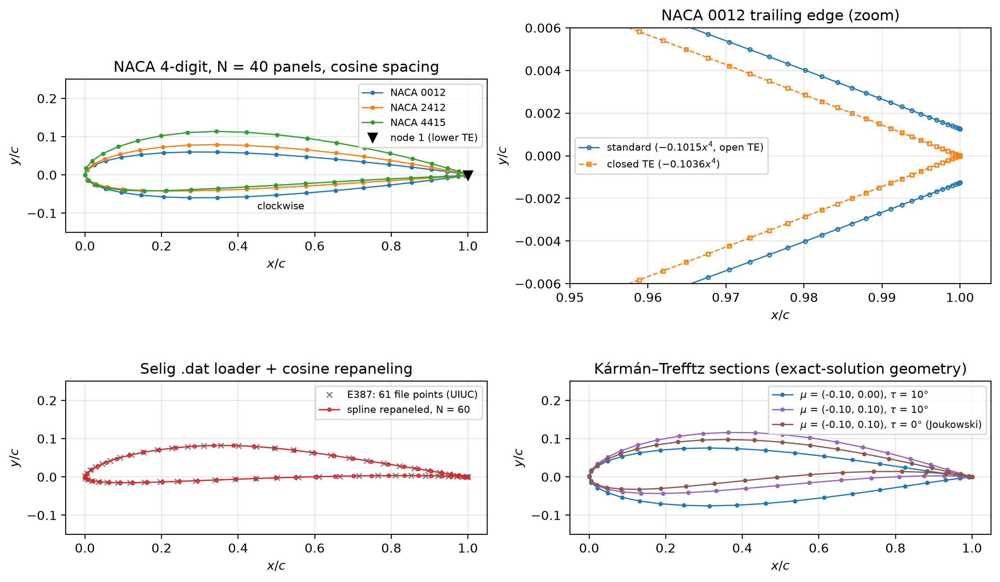

# Vortex Panel Method Airfoil Solver

A linear-strength vortex panel solver for 2D airfoils, with compressibility corrections, a critical-Mach analysis, and an airfoil analysis tool built on top.

> 🚧 **In progress.** The full write-up (validation, results, and interpretation) is added as milestones are completed.

## Scope
- NACA 4-digit and Selig `.dat` geometry with cosine panel spacing
- Linear-strength vortex panels (Kuethe & Chow formulation), flow tangency + Kutta condition
- Cp distributions, C_l–α, C_m, and streamlines
- Prandtl–Glauert and Kármán–Tsien corrections; critical Mach number
- Validation against an exact Kármán–Trefftz solution, thin airfoil theory, and XFOIL
- Airfoil analysis CLI and web app built on this solver

## Status
| Milestone | Status |
|---|---|
| 1. Airfoil geometry | ✅ Done |
| 2. Influence coefficients + linear solve | ⏳ Next |
| 3. C_l, C_m, exact-solution validation | |
| 4. XFOIL comparison + panel convergence | |
| 5. Streamlines | |
| 6. Compressibility + critical Mach | |
| 7. Full README | |
| 8. Boundary layer + drag polar (stretch) | |
| 9. Analysis tool + web app | |



## Run it
```bash
pip install -e ".[dev]"
pytest
python scripts/make_figures.py
```

## References
- Kuethe & Chow, *Foundations of Aerodynamics*, 5th ed., §5.10
- Katz & Plotkin, *Low-Speed Aerodynamics*
- Anderson, *Fundamentals of Aerodynamics*
